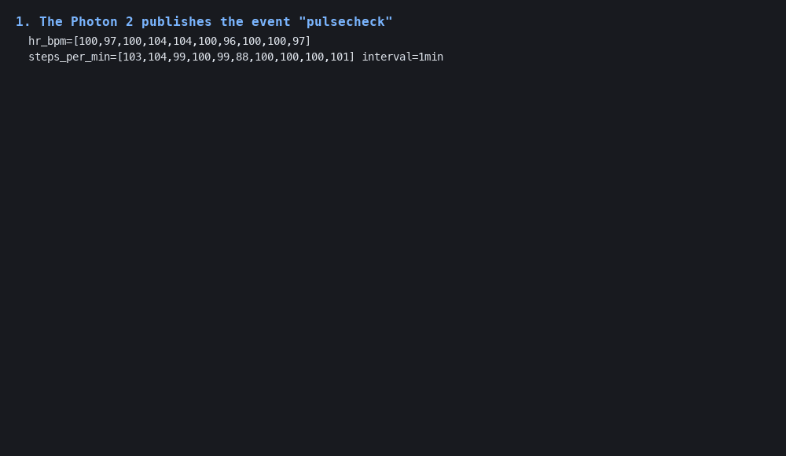

# GeminiWebhook

Send text from a Particle device to Google Gemini (or any other AI model) through a Particle webhook.

The library handles the parts that are the same in every project:

- sending no more often than your free quota allows (one request every 10 seconds by default)
- knowing whether a reply is still pending
- giving up when no reply comes (20 seconds by default)
- telling you when the webhook reports an error

You write the parts that are different in every project: the webhook, what text to send, and what to do with the answer.

Your API key goes in the webhook, in the Particle Console. It never goes in your firmware.



*A real request and reply from a Photon 2 project that uses this library. This project has no response template, so the device receives Gemini's whole reply.*

## Install

`GeminiWebhook` is in the Particle library registry.

- **Particle Workbench:** run **Particle: Install Library** and type `GeminiWebhook`
- **Particle CLI:** from your project folder, run `particle library add GeminiWebhook`

To unpack the reply you also need `ArduinoJson`, installed the same way.

Works on any Particle device that supports webhooks. Tested on a Photon 2 with Device OS 6.4.1.

## Functions

| Function | What it does |
|----------|--------------|
| `geminiSetup(eventName)` | Call once in `setup()`. `eventName` must match the webhook's event name exactly |
| `geminiSetup(eventName, minGapMs, timeoutMs)` | The same, with your own limits in milliseconds |
| `geminiLoop()` | Call every time through `loop()`. Reports a timeout if no reply came |
| `geminiSend(text)` | Publishes `text` to the webhook. Returns `false` if it was too soon or a reply is still pending |
| `geminiReady()` | `true` when `geminiSend()` would send |
| `geminiWaiting()` | `true` while a request is out and no reply has arrived |
| `geminiGotReply()` | Call at the start of your reply handler. Stops the timeout. Returns `false` for a late or duplicate reply |
| `onGeminiError(String why)` | **You define this.** Called when the webhook reports an error, no reply comes in time, or the publish fails |

## Use It

```cpp
#include "Particle.h"

#define ARDUINOJSON_ENABLE_ARDUINO_STRING 1
#include <ArduinoJson.h>

#include "GeminiWebhook.h"

void myHandler(const char* event, const char* data) {
    if (!geminiGotReply()) return;

    JsonDocument doc;
    DeserializationError error = deserializeJson(doc, data);
    if (error) {
        onGeminiError("Reply was not JSON");
        return;
    }
    String answer = doc["answer"].as<String>();   // use the keys from your own prompt
    Serial.println("Gemini says: " + answer);
}

void onGeminiError(String why) {
    Serial.println("Problem: " + why);
}

void setup() {
    Serial.begin(9600);
    geminiSetup("my_event");
    // Some webhooks put the device ID in front of the reply's name, so listen for both.
    Particle.subscribe("hook-response/my_event", myHandler, MY_DEVICES);
    Particle.subscribe(System.deviceID() + "/hook-response/my_event", myHandler, MY_DEVICES);
}

void loop() {
    geminiLoop();
    // when you want an answer:
    //   geminiSend("the text for the model");
}
```

A complete sketch is in `examples/ask-gemini`.

## Create the Webhook

In the Particle Console: **Cloud services**, **Integrations**, **Add new integration**, **Custom Webhook**, **Webhook Builder**.

| Field | Value |
|-------|-------|
| Event name | the name you pass to `geminiSetup()`, for example `my_event` |
| URL | `https://generativelanguage.googleapis.com/v1beta/models/gemini-3.5-flash-lite:generateContent` |
| Request type / format | `POST` / `JSON` |
| Extra settings: JSON data | **Custom**, then your request body (below) |
| Extra settings: HTTP headers | key `x-goog-api-key`, value your Gemini API key |
| Extra settings: Response template | the template below |
| Only the device that triggers the webhook should receive its response | either setting works with the two subscribe lines above |

A request body that asks for a JSON answer with one key, `answer`:

```json
{
  "systemInstruction": {
    "parts": [ { "text": "You read sensor data from a small device. Reply with a short answer of at most 40 characters." } ]
  },
  "contents": [
    { "role": "user", "parts": [ { "text": "{{{PARTICLE_EVENT_VALUE}}}" } ] }
  ],
  "generationConfig": {
    "responseMimeType": "application/json",
    "responseSchema": {
      "type": "OBJECT",
      "properties": { "answer": { "type": "STRING" } },
      "required": ["answer"]
    }
  }
}
```

The response template passes only the model's text back to the device:

```
{{#candidates}}{{#content}}{{#parts}}{{{text}}}{{/parts}}{{/content}}{{/candidates}}
```

The response template is optional. Without it, the device receives Gemini's whole reply, about 600 bytes in two pieces. Join the pieces, unpack the reply, and read the answer text at `doc["candidates"][0]["content"]["parts"][0]["text"]`.

Google retires models. If the webhook reports error 404, put a current model name in the URL.

## Limits

- **Long replies.** A reply longer than about 500 bytes arrives in several pieces, and your handler runs once for each piece. Keep the answer short, or join the pieces before you unpack them.
- **One request at a time.** A second `geminiSend()` while a reply is pending is refused.
- **Free quota.** The defaults suit Gemini's free tier. If you send more often, check your model's limits first.

## Test

`test/run.sh` runs the library's logic on a laptop with a stand-in for the Particle API. It needs a C++17 compiler.

## Versions

- **0.1.2**: links to this repository. No code change
- **0.1.1**: README corrections. No code change
- **0.1.0**: first release

## License

MIT. Written by Isabel Wu for USC TAC 348, Making Smart Devices.
